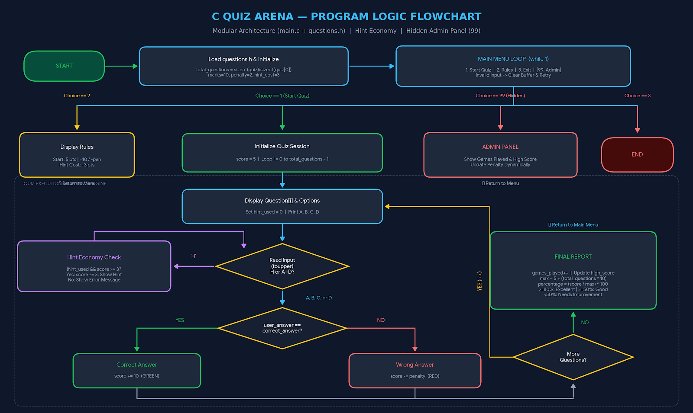

# C Quiz Arena — Quiz and Score Management System


## 1. Problem Statement
**Problem 10: Quiz and Score Management System**  
Build a command-line quiz application in C that presents multiple-choice questions one by one, accepts and validates participant answers, awards marks for correct answers with optional deductions for incorrect answers, and displays the final score, percentage, and performance category.

---

## 2. Team Details
* **Batch:** `43`
* **Team Name:** `Team JIGGLYPUFF`

---

## 3. Objectives & Key Features
* **Modular Question Bank (`questions.h`):** Separates question data from core logic (`main.c`) and uses `sizeof` to automatically detect the total number of questions whenever new ones are added.
* **Risk-Reward Hint Economy:** Players start with 5 base points and can press `H` during any question to buy a hint for `-3` points (limited to one hint per question).
* **ANSI Color Terminal UI:** Uses native ANSI escape macros (`RED`, `GREEN`, `YELLOW`, `CYAN`) for clear visual feedback without external libraries.
* **Strict Input Validation:** Clears invalid input buffers safely to prevent infinite loops and accepts both lowercase and uppercase answers via `toupper()`.
* **Hidden Admin Panel (`99`):** Entering `99` at the main menu reveals total games played, the all-time high score, and allows dynamic updates to the wrong-answer penalty at runtime.

---

## 4. Algorithm / Pseudocode
1. **Start** and load `questions.h`; calculate `total_questions = sizeof(quiz) / sizeof(quiz[0])`.
2. **Initialize** `marks_per_question = 10`, `penalty = 2`, `hint_cost = 3`, `games_played = 0`, `high_score = 0`.
3. **Loop** Main Menu (`1. Start Quiz`, `2. Rules`, `3. Exit`, hidden `99. Admin Panel`).
4. **If Choice == 1 (Start Quiz):**
   * Set `score = 5`.
   * For each question `i` from `0` to `total_questions - 1`:
     * Display question and 4 options (`A`–`D`).
     * Loop until valid input (`A`–`D`):
       * If `'H'` and hint unused and `score >= hint_cost`: deduct `hint_cost`, show hint.
       * Else if `'A'`–`'D'`: break loop.
       * Else: display invalid input message.
     * If `user_answer == correct_answer`: add `marks_per_question`.
     * Else: subtract `penalty`.
   * Increment `games_played`, update `high_score`, calculate `percentage`, and print Grade (`Excellent` >= 80%, `Good` >= 50%, `Needs Improvement` < 50%).
5. **If Choice == 2:** Display scoring and hint economy rules.
6. **If Choice == 99:** Display `games_played`, `high_score`, and accept new `penalty` value.
7. **If Choice == 3:** Exit program.

### Program Flowchart


---

## 5. C Programming Concepts Used
* **Structures (`struct`):** `struct Question` bundles question text, 4 options, correct answer, and hint.
* **1D & 2D Arrays / Strings:** `char options[4][40]` and `struct Question quiz[]`.
* **Loops (`while` & `for`):** Menu persistence, input validation retries, and question traversal.
* **Conditional Statements & Ternary Operator:** `if / else if / else` branching and score percentage clamping.
* **Custom Header File & `sizeof` Operator:** `#include "questions.h"` for modular, auto-scaling data.
* **Input Validation & `<ctype.h>`:** `scanf` return-value checking, `getchar()` buffer flushing, and `toupper()`.
* **Preprocessor Macros (`#define`):** ANSI escape sequences for terminal color formatting.

---

## 6. How to Compile and Run
Make sure `main.c` and `questions.h` are in the same folder.

### Compile
```bash
gcc main.c -o quiz
